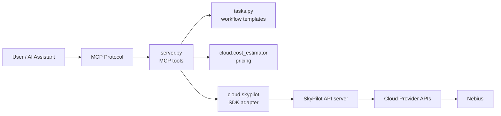

# Architecture

## Overview

VibeML is a **thin MCP (Model Context Protocol) server** over SkyPilot's client SDK. It gives AI assistants natural-language access to GPU training.

VibeML **does not** maintain its own:

- ❌ Job persistence layer (SkyPilot's API server owns cluster and job state)
- ❌ Cluster state database (SkyPilot queries cloud providers directly)
- ❌ Custom orchestration (SkyPilot handles provisioning and execution)

Instead, VibeML:

- ✅ Exposes training operations as MCP tools for AI assistants
- ✅ Provides workflow templates (Unsloth, GPT-OSS) that build SkyPilot tasks
- ✅ Adds validation and cost estimation before launch
- ✅ Translates SkyPilot's records into its own job model

## System Architecture



Each concern lives in one layer:

| Layer | Owns | Does not |
|-------|------|----------|
| `server.py` | MCP tool signatures, input validation, response shape | Talk to SkyPilot, price GPUs, build tasks |
| `tasks.py` | Turning workflow parameters into a `sky.Task` (`build_task`) | Launch anything |
| `cloud/cost_estimator.py` | GPU pricing | Know about workflows |
| `cloud/skypilot.py` | SkyPilot's request protocol, status mapping, SDK errors | Know about MCP |

## Component Responsibilities

### 1. MCP Server (`src/vibeml/server.py`)

**MCP tools**:

- `launch_training()` - Submit a training job; returns immediately with the launch request ID
- `get_training_status()` - Query a job's status
- `stop_training()` - Download logs (optional) and tear the cluster down
- `list_active_training_jobs()` - List pending and running vibeml clusters
- `estimate_training_cost()` - Price the resources a workflow would request
- `list_available_workflows()` - Describe workflow templates

The server never writes to stdout: with the stdio transport, stdout carries the MCP protocol. Diagnostics go through `logging` (stderr).

### 2. Workflow Templates (`src/vibeml/tasks.py`)

```python
WORKFLOWS = {
    "unsloth": create_unsloth_task,
    "gpt-oss-lora": create_gpt_oss_lora_task,
    "gpt-oss-full": create_gpt_oss_full_task,
}
```

Each workflow function takes model, dataset and hyperparameters and returns a configured `sky.Task` (setup script, run script, GPU resources). `build_task(workflow, model, dataset, gpu_type, **hyperparameters)` maps tool-level parameters onto a workflow's arguments. For GPT-OSS workflows the `model` argument is the size (`"20b"`, `"120b"`), and unknown sizes are rejected.

Both `launch_training` and `estimate_training_cost` use `build_task`, so the cost estimate prices exactly the resources a launch would request (GPU type, GPUs per node, node count, spot or on demand).

### 3. SkyPilot Adapter (`src/vibeml/cloud/skypilot.py`)

SkyPilot's client SDK is request-based: every call submits a request to the SkyPilot API server and returns a request ID, and `sky.get(request_id)` blocks until the result is ready. The adapter is the only module that deals with this:

```python
async def get_cluster(name: str) -> ClusterInfo | None
async def list_clusters(prefix: str) -> list[ClusterInfo]
async def launch(task: sky.Task, cluster_name: str) -> str   # request ID
async def down(name: str) -> None
async def download_logs(name: str) -> dict[str, str]        # job ID -> local dir
```

- Blocking SDK calls run in a worker thread (`asyncio.to_thread`), so the MCP event loop stays responsive.
- `launch` returns the request ID without waiting. Provisioning takes minutes, which is too long for a tool call; follow it with `sky api logs <request_id>`.
- SDK failures are raised as `SkyPilotError`, never reported as "not found".
- SkyPilot's `StatusResponse` records become vibeml's `ClusterInfo`.

## Job Status

```python
class JobStatus(str, Enum):
    PENDING = "pending"
    RUNNING = "running"
    COMPLETED = "completed"
    FAILED = "failed"
    TERMINATED = "terminated"
```

SkyPilot cluster statuses map as follows. Every `sky.ClusterStatus` member must be mapped, so a new SkyPilot status fails loudly instead of being mislabelled.

| `sky.ClusterStatus` | `JobStatus` |
|---------------------|-------------|
| `INIT`, `PENDING` | `pending` |
| `UP`, `AUTOSTOPPING` | `running` |
| `STOPPED` | `terminated` |

Torn-down clusters disappear from SkyPilot's status, so `get_training_status` reports them as not found.

## Outputs and Storage

`tasks.OUTPUTS_DIR` (`/outputs`) is the single path where training writes checkpoints and final models. With a `cloud_bucket`, the bucket is mounted at that same path, so outputs land in the bucket. A custom `output_dir` moves both together, and must be absolute because it is a mount point. Without a bucket, setup creates the directory if it does not exist, and outputs are lost when the cluster is torn down.

User-supplied values (`model`, `dataset`, `output_dir`) reach the training scripts only as environment variables (`VIBEML_MODEL`, `VIBEML_DATASET`, `VIBEML_OUTPUT_DIR`). SkyPilot exports them with shell quoting, so they are never interpreted as code.

## Cost Guard

`launch_training(max_cost=...)` enforces the budget in two places:

1. **Before launch**: the task's real resources are priced for `estimated_hours` (`CostEstimator.estimate_task`). If the expected cost exceeds `max_cost`, or the budget buys less than one minute, the tool returns `over_budget` and nothing is submitted.
2. **During the run**: the budget is converted into runtime (`CostEstimator.affordable_minutes`, the budget divided by the hourly rate). The cluster is launched with SkyPilot autostop set to that many minutes, `wait_for=NONE` and `down=True`. It is torn down when the budget's runtime is up, even if training is still running. If the SkyPilot API server is too old to honour `wait_for` (API version below 13), the launch is refused rather than run uncapped.

What the cap covers, and what it does not:

- SkyPilot arms autostop after provisioning, file and storage sync, and setup. vibeml keeps setup to output-directory preparation and installs dependencies at the start of the run, so slow or hanging installs and training are covered.
- **Failed launches are cleaned up by the launcher.** `launch_training` returns immediately, but the MCP server keeps watching the launch request, even if the MCP call is cancelled. When the API server confirms the request failed or was cancelled (provisioning, storage mount, directory setup), the server tears the cluster down. Errors observing the request, such as a dropped connection, are retried and never treated as failure, so a healthy job is not torn down by mistake. Pass `keep_on_failure=True` to keep a failed cluster for debugging.
- **Not covered** (check `sky status` if in doubt):
    - Provisioning and setup time is billed but not counted against the cap.
    - A launch that hangs before the job starts (stuck provisioning, mount or setup) has no timer armed, and the watcher only acts once the request settles.
    - If the teardown of a failed launch itself fails, it is logged, not retried.
    - If the vibeml server process stops before a failed launch settles, nothing tears the cluster down.
- The timer is polled about once a minute, and cloud teardown takes time, so the cap is approximate. Prices are vibeml's Nebius estimates, including the spot discount.

## Request Flow

```
launch_training()
    → TrainingRequest validation (Pydantic)
    → build_task() → sky.Task
    → skypilot.launch() → sky.launch() → request ID
    ← {"status": "submitted", "cluster_id", "launch_request_id", "logs_command"}

get_training_status(cluster_id)
    → skypilot.get_cluster() → sky.get(sky.status([cluster_id]))
    ← {"status": "running", "sky_status": "UP", "launched_at": ...}

stop_training(cluster_id)
    → skypilot.download_logs() → sky.download_logs()
    → skypilot.down() → sky.get(sky.down(cluster_id))
    ← {"status": "stopped", "log_paths": {...}}
```

## Data Models

### TrainingRequest

Validates user input before a task is built:

```python
class TrainingRequest(BaseModel):
    model: str              # "meta-llama/Llama-3.2-1B"
    dataset: str            # "tatsu-lab/alpaca"
    workflow: str           # "unsloth" | "gpt-oss-lora" | "gpt-oss-full"
    gpu_type: str | None    # "L40S" | "RTX4090" | "H100" | "A100"
    max_cost: float | None  # Budget limit in USD
    hyperparameters: dict   # learning_rate, lora_r, max_seq_length, etc.
```

## Why This Architecture?

**Benefits**:

- **No state drift**: SkyPilot is the only source of truth for clusters
- **Survives restarts**: job state persists if the VibeML server stops
- **Direct access**: users can use `sky` CLI commands alongside VibeML
- **Replaceable edges**: the MCP layer and the SkyPilot adapter can change independently

**Trade-offs**:

- Cannot store job metadata beyond what SkyPilot tracks
- No history after a cluster is torn down

## Testing Strategy

- `tests/test_skypilot.py` tests the adapter against mocked SDK responses built from SkyPilot's real `StatusResponse` and `ClusterStatus` types, so a change in SkyPilot's response shape breaks the tests.
- `tests/test_server.py` calls the tools through FastMCP's in-memory `Client`, the same path a real MCP client uses, with the adapter mocked.
- `tests/test_tasks.py` covers the workflow templates and `build_task`.

No test launches real cloud resources.

## Error Handling

Every tool returns errors as data instead of raising:

```python
{"status": "error", "error": "validation_error", "message": "..."}
{"status": "error", "error": "skypilot_error", "message": "..."}
{"status": "error", "error": "not_found", "message": "..."}
```

Validation errors are caught before anything reaches SkyPilot.

## References

- [SkyPilot Documentation](https://skypilot.readthedocs.io/)
- [FastMCP Documentation](https://github.com/jlowin/fastmcp)
- [Model Context Protocol Spec](https://modelcontextprotocol.io/specification)
- [Nebius Cloud Documentation](https://nebius.com/docs/)
