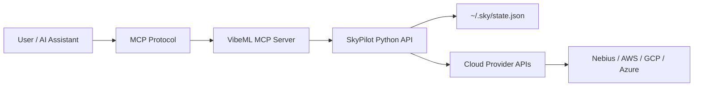

# Architecture

## Overview

VibeML is a **thin MCP (Model Context Protocol) wrapper** around SkyPilot's Python API, providing natural language access to multi-cloud GPU training.

VibeML **does not** maintain its own:

- ❌ Job persistence layer (SkyPilot has `~/.sky/state.json`)
- ❌ Cluster state database (SkyPilot queries cloud providers directly)
- ❌ Custom orchestration (SkyPilot handles provisioning/execution)

Instead, VibeML:

- ✅ Wraps SkyPilot's Python API (`sky.launch()`, `sky.status()`, `sky.down()`)
- ✅ Exposes these as MCP tools for AI assistants
- ✅ Adds validation and cost guardrails
- ✅ Provides workflow templates (Unsloth, GPT-OSS)
- ✅ Translates natural language requests to SkyPilot Tasks

## System Architecture



## Component Responsibilities

### 1. MCP Server Layer (`src/vibeml/server.py`)

**Purpose**: FastMCP server exposing training operations as tools

**MCP Tools Provided**:

- `launch_training()` - Start a new training job
- `get_training_status()` - Query job status
- `stop_training()` - Terminate a running job
- `list_active_training_jobs()` - List all active jobs
- `estimate_training_cost()` - Calculate costs before launch
- `list_available_workflows()` - Show workflow templates

**Key Functions**:

- Request validation (Pydantic models)
- Natural language to SkyPilot Task translation
- Cost estimation and budget enforcement
- Status mapping (SkyPilot → VibeML JobStatus)

**Does NOT**:

- Store job records in a database
- Maintain cluster state
- Track training progress (delegates to SkyPilot)

### 2. Workflow Templates (`src/vibeml/tasks.py`)

**Purpose**: Generate SkyPilot Task objects for common training patterns

**Available Workflows**:

```python
WORKFLOWS = {
    "unsloth": create_unsloth_task,
    "gpt-oss-lora": create_gpt_oss_lora_task,
    "gpt-oss-full": create_gpt_oss_full_task,
}
```

Each workflow function:

- Takes model/dataset/hyperparameters as input
- Returns a configured `sky.Task` object
- Sets appropriate GPU resources
- Configures training scripts

**Example** (Unsloth workflow):

```python
def create_unsloth_task(
    model: str,
    dataset: str,
    gpu_type: str = "L40S",
    max_steps: int = 60,
    ...
) -> sky.Task:
    return sky.Task(
        name=f"vibeml-unsloth-{model}",
        setup="pip install unsloth transformers",
        run=training_script,
        resources=sky.Resources(
            cloud="nebius",
            accelerators=f"{gpu_type}:1",
            use_spot=True,
        ),
    )
```

### 3. State Management (SkyPilot-Native)

**How SkyPilot Manages State**:

SkyPilot maintains job state in `~/.sky/state.json`:

```
~/.sky/
├── state.json           # Global state: all clusters
├── catalogs/            # Cloud provider catalogs
└── vibeml-unsloth-abc123/  # Per-cluster state
    ├── jobs.yaml        # Job queue
    └── metadata.json    # Cluster metadata
```

**VibeML queries this state** via SkyPilot's Python API:

```python
# Get cluster status
clusters = sky.status(cluster_names=["vibeml-unsloth-abc123"], refresh=True)

# Returns list of ClusterRecord objects with:
# - name, status, launched_at
# - resources (GPU type, cloud, region)
# - handle (cloud-specific metadata)
```

**State reconciliation**: SkyPilot queries cloud provider APIs during `refresh=True` to sync local state with actual cluster status.

## Request Flow Example

### Lifecycle

```
User Request
    ↓
    → launch_training()
    ↓
    → Validate TrainingRequest (Pydantic)
    ↓
    → Get workflow function (e.g., create_unsloth_task)
    ↓
    → Generate SkyPilot Task object
    ↓
    → sky.launch(task, cluster_name="vibeml-unsloth-abc123")
    ↓
SkyPilot provisions cluster, stores state
    ↓
    → Return cluster_id to user
    ↓
User monitors via get_training_status()
    ↓
    → _get_cluster_from_skypilot(cluster_id)
    ↓
    → sky.status(cluster_names=[cluster_id])
    ↓
    → Map SkyPilot status to JobStatus
    ↓
    → Return status to user
```

### Tool Interactions

```python
# User: "Train Llama-3.2-1B on Alpaca with L40S GPU"

# 1. MCP Tool Call
launch_training(
    model="meta-llama/Llama-3.2-1B",
    dataset="tatsu-lab/alpaca",
    workflow="unsloth",
    gpu_type="L40S",
)

# 2. VibeML Validates & Translates
task = create_unsloth_task(
    model="meta-llama/Llama-3.2-1B",
    dataset="tatsu-lab/alpaca",
    gpu_type="L40S",
)

# 3. SkyPilot Launches
cluster_handle = sky.launch(
    task,
    cluster_name="vibeml-unsloth-abc123",
    detach_run=True
)

# 4. User Monitors
status_data = await _get_cluster_from_skypilot("vibeml-unsloth-abc123")
# Returns: {"status": "UP", "launched_at": "2025-10-26T...", ...}
```

## Data Models

### TrainingRequest

**Purpose**: Validate user input before processing

```python
@dataclass
class TrainingRequest:
    model: str              # "meta-llama/Llama-3.2-1B"
    dataset: str            # "tatsu-lab/alpaca"
    workflow: str           # "unsloth" | "gpt-oss-lora" | "gpt-oss-full"
    gpu_type: str | None    # "L40S" | "RTX4090" | "H100" | "A100"
    max_cost: float | None  # Budget limit in USD
    hyperparameters: dict   # learning_rate, lora_r, max_seq_length, etc.
```

### JobStatus Enum

**Purpose**: User-friendly status abstraction

```python
class JobStatus(str, Enum):
    PENDING = "pending"      # SkyPilot: INIT
    RUNNING = "running"      # SkyPilot: UP
    COMPLETED = "completed"  # (Inferred from logs/exit code)
    FAILED = "failed"        # (Error states or unknown)
    TERMINATED = "terminated" # SkyPilot: STOPPED, TERMINATED
```

**Mapping function**:

```python
def _map_sky_status_to_job_status(sky_status: str) -> JobStatus:
    """Map SkyPilot cluster status to VibeML JobStatus."""
    status_map = {
        "INIT": JobStatus.PENDING,
        "UP": JobStatus.RUNNING,
        "STOPPED": JobStatus.TERMINATED,
        "TERMINATED": JobStatus.TERMINATED,
    }
    return status_map.get(sky_status, JobStatus.FAILED)
```

## Why This Architecture?

**Benefits**:

- **Simpler**: ~600 lines of SQLite code removed
- **More Reliable**: No state drift between VibeML and SkyPilot
- **Survives Restarts**: Job state persists even if VibeML server crashes
- **Zero Reconciliation**: SkyPilot handles cloud provider sync
- **Direct Access**: Users can use `sky` CLI commands alongside VibeML

**Trade-offs**:

- Cannot customize job metadata beyond what SkyPilot tracks
- Tied to SkyPilot's state schema (currently not an issue)
- No historical data after cluster deletion (acceptable for MVP)

## Testing Strategy

### Unit Tests (`tests/test_server_skypilot.py`)

Test helper functions that interact with SkyPilot:

```python
class TestStatusMapping:
    """Test SkyPilot status to JobStatus mapping."""

    def test_map_init_to_pending(self):
        assert _map_sky_status_to_job_status("INIT") == JobStatus.PENDING

    def test_map_up_to_running(self):
        assert _map_sky_status_to_job_status("UP") == JobStatus.RUNNING

class TestGetClusterFromSkyPilot:
    """Test _get_cluster_from_skypilot helper."""

    @pytest.mark.asyncio
    async def test_get_existing_cluster(self):
        # Mock sky.status() to return cluster info
        result = await _get_cluster_from_skypilot("test-cluster")
        assert result["cluster_name"] == "test-cluster"
```

### Integration Tests

Would test end-to-end MCP tool calls:

- Launch → Status → Stop workflow
- Cost estimation accuracy
- Error handling (no GPU availability, quota limits)

## Error Handling

### SkyPilot Errors

VibeML lets most SkyPilot exceptions bubble up with context:

```python
try:
    cluster_handle = await loop.run_in_executor(
        None,
        lambda: sky.launch(task, cluster_name=cluster_id)
    )
except Exception as e:
    raise SkyPilotError(f"Failed to launch training: {str(e)}")
```

### Validation Errors

Pydantic validation catches bad inputs early:

```python
try:
    request = TrainingRequest(
        model=model,
        dataset=dataset,
        workflow=workflow,
        ...
    )
except PydanticValidationError as e:
    return {
        "status": "error",
        "error": "validation_error",
        "message": str(e),
        "details": e.errors(),
    }
```

## References

- [SkyPilot Documentation](https://skypilot.readthedocs.io/)
- [FastMCP Documentation](https://github.com/jlowin/fastmcp)
- [Model Context Protocol Spec](https://modelcontextprotocol.io/specification)
- [Nebius Cloud Documentation](https://nebius.com/docs/)
